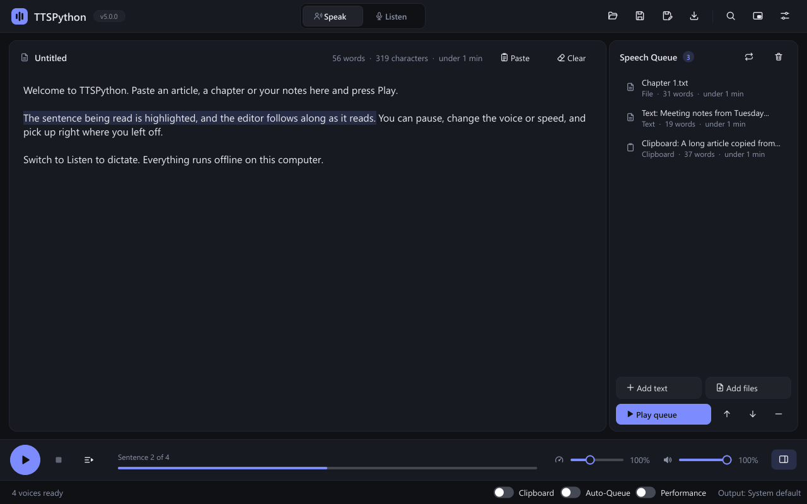
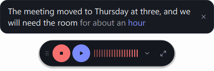
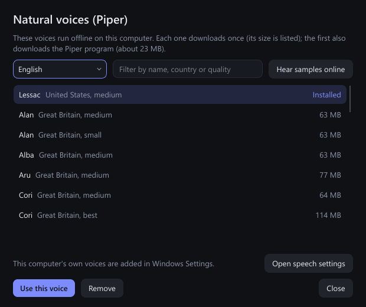
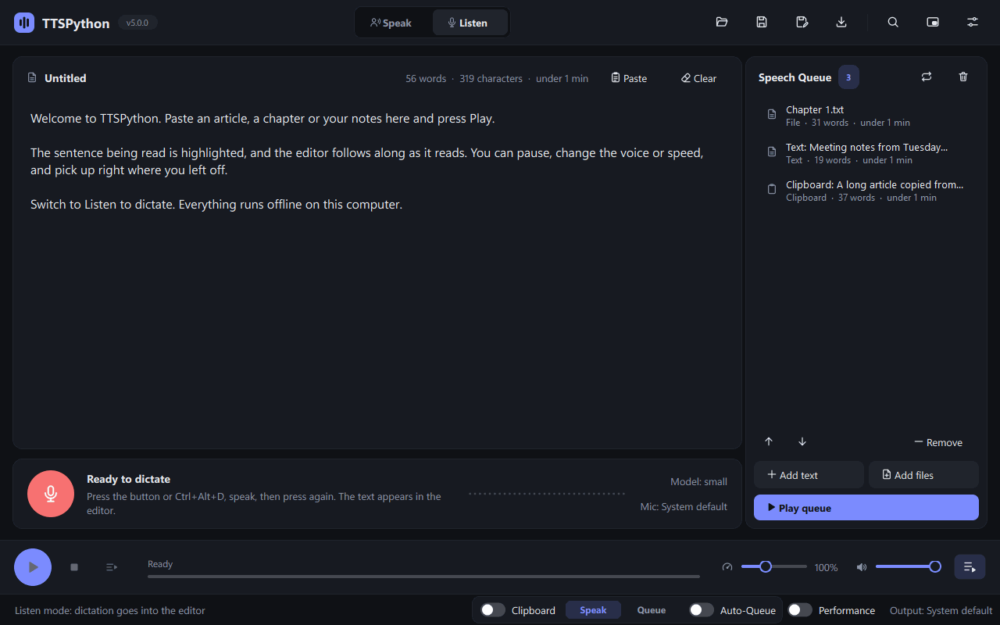
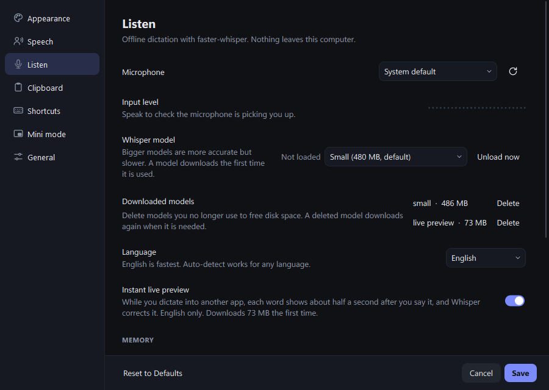

# TTSPython

An offline text-to-speech (TTS) and speech-to-text (STT) desktop app for Windows and Linux, with a full editor window and a floating mini bar that works over any app. Speech uses your system voices (SAPI5 on Windows, espeak-ng on Linux) or natural-sounding Piper voices you download once, and dictation runs locally with `faster-whisper`. Nothing you read or say leaves your computer.



| Dictating into any app, with live captions | Natural voices, downloaded once |
|:---:|:---:|
|  |  |

| Listen mode | Settings > Listen |
|:---:|:---:|
|  |  |


## Features

### Speak (text-to-speech)
- **Play / Pause / Stop** with a media-player style control bar, plus **Speak selected** and **Speak from here** (from the sentence where the cursor is; also in the editor's right-click menu).
- The sentence being read is **highlighted** and the editor follows along.
- **Speed** (50% to 200%, 100% is normal) and **volume** change **while it speaks**: drag the speed slider and you hear every step as you drag (within 16 ms), mid-sentence, with the same pitch. Changing the **voice** mid-sentence continues from the word being read.
- **More voices:** besides the system voices (including the Windows 11 voices Windows hides from older apps, such as Mark), **Settings > Speech > Get more voices** downloads natural-sounding **Piper** voices: dozens in English and many other languages, about 60 MB each, downloaded once and then fully offline.
- Choose the **output device** in Settings (speakers, headset, virtual cable); every device from every audio system is listed, and **Refresh** finds one you plugged in later.
- Speech starts within a fraction of a second, even for very long texts, because it is prepared a few seconds ahead of what you hear.

### Listen (speech-to-text)
- Offline dictation with `faster-whisper` (CPU, int8). Press the record button, speak, press again.
- **Live captions:** when you dictate into another app, a bubble above the mini bar shows each word about half a second after you say it, so you can spot a mistake early. A fast **instant preview** recognizer shows the words first (slightly dimmer); Whisper then checks them and corrects them in place, and the newest word is highlighted. The bubble grows a line at a time (up to three), with the newest words right above the bar. Its **X** (or `Esc`) cancels the dictation and nothing is typed.
- **Typed right after you stop:** Whisper checks the text whenever you pause, so if you pause before stopping, the text is typed almost at once (usually under 0.1 s in tests, 0.6 s at most); otherwise in about 0.5 to 1.2 s. Long dictations settle at real pauses as you go, so this stays short however long you talk.
- Dictation keeps full speed while TTSPython is in the background (Windows 11 would otherwise slow it down 2.6 times while you work in another app).
- Pick the **Whisper model** (from Tiny to Large v3 Turbo) and the **language**: English by default, Auto-detect, or Spanish, French, German, Italian, Portuguese, Dutch, Polish, Russian, Ukrainian, Turkish, Arabic, Hindi, Japanese, Korean or Chinese.
- The model loads while you are still talking and can unload itself after a set idle time to free memory.

### Mini mode
- A small **floating bar** that stays on top of every window and **never takes focus**, so your cursor stays where you were typing.
- **Mic button**: dictate, and the text is **typed where your cursor is** in any app (or copied to the clipboard, if you prefer).
- **Play button**: reads the text you have **highlighted** in any app (or the **clipboard** if nothing is highlighted); press again to stop.
- **Live waveform** while speaking or listening, plus a quick **voice, speed, volume and Pause** popover (chevron or right-click). Scroll the mouse wheel over the bar to change the volume.
- Drag it anywhere; it snaps to screen edges and remembers its position.

### Global hotkeys
Work even when TTSPython is in the background. All can be changed in **Settings > Shortcuts**.

| Action | Default |
|--------|---------|
| Start or stop dictation | `Ctrl+Alt+D` |
| Speak highlighted text or clipboard (press again to stop) | `Ctrl+Alt+S` |
| Stop speaking | `Ctrl+Alt+X` |
| Show or hide mini mode | `Ctrl+Alt+Shift+M` |
| Pause or resume speech, Show main window | unassigned |

### Speech queue
- Add the editor text, text files or clipboard items and play them back to back.
- **Drag to reorder** (or the up and down arrows), **Remove** (the minus button or the Delete key), **Clear**, **Loop**.
- Double-click an item (or press `Enter`) to play from there; right-click for Play from here, Move to top, Copy to the editor and Remove. Each item shows how long it takes to listen to.
- Drop text files on the queue to add them, even when it is empty. The playing item is marked, editing the queue while it plays is safe, and the queue is kept for the next start.

### Clipboard monitor
- Watches the clipboard and either **speaks** or **queues** copied text (6 characters or more).
- **Auto-Queue**: while speech is playing, copied text is queued instead of ignored, then played once. When reading ends, the queue is read next (this part works with the clipboard monitor off too).

### Export audio
- Save the text (or just the selected part) as **WAV** or **MP3** with the current voice, speed and volume. Export runs in the background with progress and a Cancel button, writes as it goes (a whole book never sits in memory), remembers the folder and format, and offers **Open folder** when done.

### Editor
- **New**, open and save text files (UTF-8, UTF-16 and Windows-1252) without changing their encoding or line endings. A file in another encoding (such as GBK or Shift-JIS) can look wrong; you are told when it opens, and Save asks where to save, so the original stays as it is. The **Open** button's arrow lists recent files, and you can drop a text file on the editor to open it. The window title shows the file name and whether it has unsaved changes. Closing with unsaved text asks first.
- Unsaved text is kept every 30 seconds, so it comes back after a crash or a logoff.
- The word count also shows the reading time at the current speed.
- Inline **Find and replace** (`Ctrl+F`) with match case, regular expressions, previous/next with wrap-around, a match count ("2 of 5"), Replace and Replace all (one undo step).

### Look and feel
- 12 themes: **Studio** (new default), Dark, Twilight, Light, High Contrast, Forest, New Vegas, Spiral, Poly, Sunset, Paper, Graphite. Every theme is checked for readable text contrast.
- **Performance Mode** reduces animations and redraws for slower PCs.
- **System tray** icon (Show window, Mini mode, Speak selection or clipboard, Pause or resume, Stop, Settings, Quit). Its tooltip says what is happening, and a red dot shows while dictation records. Optionally, closing the window keeps TTSPython running in the tray.
- The window, Settings and mini bar fit small windows and large display scaling without cutting anything off.

## Requirements
- **Windows 10/11** or **Linux** (X11 or Wayland).
- Python 3.9 or newer (developed and tested on Python 3.13).
- Python packages (installed by the scripts below): `PySide6-Essentials`, `pyttsx3`, `numpy`, `sounddevice`, `lameenc`, `faster-whisper`, `sherpa-onnx` (the instant live preview); on Windows also `comtypes` (talks to the SAPI5 voices; pyttsx3 brings `pywin32` for its fallback driver); on Linux also `pynput`.
- Linux system packages: `espeak-ng`, `portaudio`, `xcb-util-cursor` (Debian/Ubuntu: `libxcb-cursor0`). Optional: `wtype` to type dictation at the cursor on Wayland.

## Installation

### Ready-to-run app (no Python needed)
Download the latest build from [Releases](https://github.com/JoshLongmire/TTSPython/releases):
- **Windows:** `TTSPython-<version>-windows-x64.zip`. Extract it anywhere and run `TTSPython\TTSPython.exe`.
  The app is not code-signed, so SmartScreen may warn you: choose **More info > Run anyway**.
- **Linux:** `TTSPython-<version>-linux-x86_64.tar.gz`. Extract it and run `TTSPython/install.sh` (installs for your
  user only: app menu entry and a `ttspython` command; `uninstall.sh` removes it). It also needs
  `espeak-ng`, `libportaudio2` and `libxcb-cursor0` from your distribution; the installer tells you if one is missing.
  Built on Ubuntu 22.04, so it runs on distributions from 2022 or newer.

The first dictation downloads the Whisper model you picked (once) and the live preview model (73 MB, once, English only), and a Piper voice downloads when you pick it, so the app needs internet for those.

### From source: Windows
1. Install Python 3.9 or newer from [python.org](https://www.python.org/downloads/windows/) (tick **Add Python to PATH**).
2. Get the code and install the dependencies:
   ```powershell
   git clone https://github.com/JoshLongmire/TTSPython.git
   cd TTSPython
   ./dependencies.bat
   py TTSPython.py
   ```

> **First run tip:** If Windows Defender or SmartScreen warns you, choose **More info > Run anyway**. TTSPython is a plain Python script, not a signed installer.

### From source: Linux (Arch and others)
1. System packages (Arch example):
   ```bash
   sudo pacman -S python espeak-ng portaudio xcb-util-cursor
   ```
2. Get the code and install the Python dependencies:
   ```bash
   git clone https://github.com/JoshLongmire/TTSPython.git
   cd TTSPython
   chmod +x dependencies.sh
   ./dependencies.sh
   source .venv/bin/activate
   python TTSPython.py
   ```
   `dependencies.sh` creates a `.venv` and installs from `requirements.txt` (with `uv` if available, otherwise `pip`).

## Usage

### Reading text aloud
1. Type or paste text into the editor.
2. Press **Play** (`Ctrl+Enter`). Press it again to pause, and again to resume.
3. Select text and press **Speak selected** (`Ctrl+Shift+Enter`) to read just that part.
4. **Stop** (`Esc`) ends speech right away.

### Dictating into the editor
1. Switch the top toggle from **Speak** to **Listen** (`Ctrl+M`).
2. Press the red record button, speak, press it again. The text is added to the editor.

### Dictating into any app
1. Press `Ctrl+Alt+D` (or the mic in mini mode) while your cursor is in another app.
2. Speak. A caption bubble shows each word as you say it. Dimmer words are the instant preview's first guess; Whisper checks them a moment later (usually when you pause) and corrects them in place.
3. Press it again. The text is typed where your cursor is. If the window changed in the meantime, the text is copied to the clipboard instead and a note tells you so. Press `Esc` or the bubble's **X** to throw the dictation away instead.

### Mini mode
- Click the **Mini mode** button in the top bar, press `Ctrl+Alt+Shift+M`, or use the tray menu.
- Highlight text in any app and press the bar's **Play** button (or `Ctrl+Alt+S`) to hear it. With nothing highlighted, it reads the clipboard.
- The expand button on the bar brings the full window back.

### Command line
These also work while TTSPython is already running (the running copy receives them), which is handy for desktop shortcuts and for Wayland, where apps cannot register global hotkeys:

```
python TTSPython.py --mini               Show the floating mini bar
python TTSPython.py --toggle-dictation   Start or stop dictation into the active app
python TTSPython.py --speak-clipboard    Speak the highlighted text, or the clipboard (or stop speaking)
python TTSPython.py --stop               Stop speaking
python TTSPython.py --pause              Pause or resume speech
python TTSPython.py --show               Show the main window
python TTSPython.py --quit               Quit the running app
python TTSPython.py --settings PATH      Use a different settings file
python TTSPython.py --version            Print the version
```

With the ready-to-run app, use `TTSPython.exe --mini` (Windows) or `ttspython --mini` (Linux) the same way.

### Adding voices
- **Natural voices (Windows and Linux):** **Settings > Speech > Get more voices**, pick a language and a voice, press **Download**, then **Use this voice**. The first one also downloads the Piper program (about 23 MB). **Hear samples online** opens the official samples page. Voices are stored in `%LOCALAPPDATA%\TTSPython` (Windows) or `~/.local/share/ttspython` (Linux) and can be removed again in the same window.
- **Windows voices:** the same window opens Windows Speech settings (`ms-settings:speech`); install voices there, then press **Refresh**.
- **Linux system voices:** install espeak-ng language data with your package manager, then press **Refresh**.
- See [`ADD_VOICES_GUIDE.md`](ADD_VOICES_GUIDE.md) for details. Run `python check_voices.py` to list installed voices.

## Keyboard shortcuts (in the window)

All can be changed in **Settings > Shortcuts**.

| Action | Default |
|--------|---------|
| Speak all | `Ctrl+Enter` |
| Speak selected | `Ctrl+Shift+Enter` |
| Speak from the cursor | `Ctrl+Alt+Enter` |
| Pause or resume | `Ctrl+Space` |
| Stop | `Esc` |
| New document | `Ctrl+N` |
| Open file | `Ctrl+O` |
| Save | `Ctrl+S` |
| Save as | `Ctrl+Shift+S` |
| Paste | `Ctrl+V` |
| Clear text (undo with `Ctrl+Z`) | `Ctrl+L` |
| Find and replace | `Ctrl+F` |
| Export audio | `Ctrl+E` |
| Switch Speak / Listen | `Ctrl+M` |
| Show or hide the queue | `Ctrl+Q` |
| Settings | `Ctrl+,` |

While you dictate into another app, `Esc` cancels the dictation (only then; it is given back afterwards).

## Settings

Settings are saved automatically to:
- **Windows:** `%APPDATA%\TTSPython\settings.json`
- **Linux:** `~/.config/ttspython/settings.json`

Unsaved editor text is kept next to the settings file every 30 seconds (`recovery.json`) and put back the next
time TTSPython starts after a crash, logoff or shutdown. The speech queue is kept there too (`queue.json`).

The first time TTSPython 5 starts, it imports your old `tts_settings.json` from the app folder (theme, shortcuts, clipboard, dictation and window size). The old file is left untouched.

The Settings window has these pages: **Appearance** (theme gallery, Performance Mode), **Speech** (voice and Get more voices, speed and volume, which apply as you move them, output device with Refresh and Test, sentence highlight), **Listen** (microphone with a live level meter, Whisper model, downloaded models (Whisper and the live preview) with their size and a Delete button, language, **Instant live preview** on or off, memory options, how dictation reaches other apps), **Clipboard**, **Shortcuts** (in-window and global), **Mini mode** and **General** (tray behavior, settings file location). **Save** keeps the changes and closes; **Cancel** undoes them, previews included; closing with unsaved changes asks. The Output, Model and Mic labels in the main window open the matching page.

## Troubleshooting

### No voices available
- Download a natural voice in **Settings > Speech > Get more voices** (works on Windows and Linux).
- **Windows:** system voices come from SAPI5 (built into Windows) and the Windows 11 speech voices. Install more in Windows Speech settings, then **Refresh**.
- **Linux:** install `espeak-ng` and confirm `espeak-ng "hello"` works in a terminal.
- Run `python check_voices.py` to list what is installed.

### No sound
- Check **Settings > Speech > Output device** and press **Test**. "System default" follows your OS default device. Plugged in a headset after starting TTSPython? Press **Refresh** next to the device list.
- On Linux, make sure `portaudio` is installed.

### The first dictation takes a while
- The first time you use a Whisper model it is downloaded once (Small is about 480 MB). The download progress shows
  in the status bar, the Listen panel, and next to the mini bar; your recording is transcribed as soon as it finishes.
  Pick **Tiny** or **Base** in **Settings > Listen** for a smaller download.
- The live preview model (73 MB) also downloads once, in the background; its progress shows in the status bar
  only, and until it is ready the captions come from Whisper alone (about every 1.5 s). Turn the preview off in
  **Settings > Listen > Instant live preview**.

### The caption shows a wrong word
- The dimmer words come from the instant preview, which is fast but less accurate. Whisper corrects them a moment
  later, and only Whisper's text is typed.

### Play reads the clipboard instead of what I highlighted
- Play reads the highlight through Windows UI Automation, which most apps support. Apps that don't support it get a
  quick `Ctrl+C` instead, and your clipboard is put back right after. Terminals never get `Ctrl+C` (it would stop the
  running program), so in a terminal, copy the text first.
- On Linux, Play reads the primary selection (the text you last highlighted in any app).

### Dictation says the microphone sent only silence
- The microphone is muted, or Windows does not let apps use it: **Settings > Privacy & security > Microphone**, turn on access for desktop apps.

### Dictation is not typed into another app
- Some apps running as administrator block simulated typing; the text is put on the clipboard instead, so press `Ctrl+V`.
- Terminals often paste with `Shift+Insert`: change **Settings > Listen > Paste using** (also used with `wtype` on Wayland).
- If you still hold `Alt` or `Shift` from the stop hotkey, the text is copied instead of pasted (pasting then would trigger another command): press `Ctrl+V`.
- On Wayland, install `wtype`, or use the clipboard option.

### A global hotkey does not work
- On Windows, **Settings > Shortcuts** shows "Already used by another app" next to any hotkey another program owns, and the status bar says so at start. A pop-up tells you once, the first time a key is found taken, not on every start. Pick a different combination (global hotkeys are paused while you type one in). TTSPython tries again a few seconds after starting, in case the key was only busy for a moment.
- On Wayland, bind the command-line options above in your desktop's keyboard settings instead.

### The window looks wrong on Linux
- Install `xcb-util-cursor` (`libxcb-cursor0` on Debian/Ubuntu). On Wayland, TTSPython runs through XWayland (when it is available) so the mini bar can stay on top.

### Export to MP3 is missing
- MP3 needs the `lameenc` package: `pip install lameenc`. WAV export always works.

## Development

```bash
python -m pip install -r requirements-dev.txt
python -m pytest                 # unit and UI tests (offscreen, fake audio)
python -m pytest -m audio        # real speech engine and speakers
python -m pytest -m desktop      # mini bar focus check on the real Windows desktop
python -m pytest -m legacy       # the bug specs, run against v4.1.0 from git (expected to fail there)
python tools/bench/bench.py --target v5 --runs 10 --metrics startup   # startup time and memory
python tools/bench/bench.py --target v5 --metrics ttfa                # time to first audio (speaks; needs silence)
python tools/screenshots.py --out shots --themes all --extras
```

Tests never touch your real settings: they use temporary files, and a guard fails the run if a real settings file changes.

### Building the ready-to-run app
```bash
build.bat        # Windows: dist/TTSPython/TTSPython.exe and dist/TTSPython-<version>-windows-x64.zip
./build.sh       # Linux:   dist/TTSPython/TTSPython and dist/TTSPython-<version>-linux-<arch>.tar.gz
```
Each system builds its own app (PyInstaller cannot build for another OS). Build Linux on the oldest distribution
you want to support. Pushing a `v*` tag runs `.github/workflows/build.yml`, which builds and smoke-tests both
and attaches them to the GitHub release. To check a build, run it with `TTSPYTHON_SELFTEST=<report.json>`: it loads
every part (voices, the Piper voice list, MP3 export, Whisper libraries, the live preview engine and, if downloaded,
its model, audio devices), writes the report (with a `problems` list, empty when all is well) and quits,
without sound. `python packaging/build.py --check` does this right after building and fails if it finds a problem. Add `TTSPYTHON_SELFTEST_STT=tiny` to also dictate a spoken test phrase through the real transcription
path, played in real time with live captions (downloads that model if needed; the result is never typed anywhere).
`TTSPYTHON_SELFTEST_PHRASE` changes the phrase, `TTSPYTHON_SELFTEST_LIVE=0` turns the captions off for comparison,
and `TTSPYTHON_SELFTEST_VOICE=<voice id>` exports the test MP3 with that voice (for example a downloaded Piper voice).

## License

Released under the MIT License. See the [`LICENSE`](LICENSE) file.

Piper voices are spoken by the official [Piper](https://github.com/rhasspy/piper) program (MIT, with espeak-ng under
GPL-3.0), which TTSPython downloads and runs as a separate program; it is not part of TTSPython. Each voice has its
own license (see its model card on [Hugging Face](https://huggingface.co/rhasspy/piper-voices)).

## Changelog

See [`CHANGELOG.md`](CHANGELOG.md) for the full version history.

## Additional guides

- [`FEATURE_GUIDE.md`](FEATURE_GUIDE.md): in-depth feature walkthrough.
- [`QUICK_REFERENCE.md`](QUICK_REFERENCE.md): shortcuts and workflows at a glance.
- [`ADD_VOICES_GUIDE.md`](ADD_VOICES_GUIDE.md): installing and managing voices.
